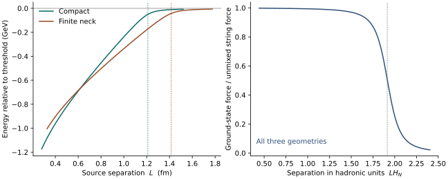

# A static colour pair on the compact, neck and shrinking Hopf geometries

We ask whether the weak geometry changes the static colour force between a heavy down-type source and its antiquark, and whether it determines where their flux tube breaks. We vary the weak shape and then its radius on the **broken** trajectory of issue 29, in the same four-dimensional Einstein frame. We keep the colour charge, the minimal external source and the projected action of 99.2 fixed. In the hadronic calculation we also keep the renormalized colour and quark-mass inputs of 100 fixed in colour-radius units. The calculation below gives a resolved force contribution directly from the parent and the screened ground-state energy in the matched QCD sector. [Trajectory and strong inputs](29.md) · [Colour action](../99_nonround_hopf_colour_gap_and_level_crossing.md) · [Mass trajectory](../100_hopf_light_fermion_window_and_hadronic_calibration.md)

## The external source

Take a nondynamical $(\mathbf3,\mathbf1)_{Y=-1/3}$ source and its conjugate in a colour singlet. It has triality one, $6Y=-2\equiv1\bmod3$, and weights $(P,C,T_3)=(5/2,-3,0)$ throughout the path. At resolved distances we give the Wilson source the unperturbed horizontal $d_R$ density and its minimal metric connection. The source can be taken static independently of the Yukawa mass of a dynamical down quark. At hadronic distances we evaluate the colour part in isospin-symmetric QCD with the electromagnetic and weak couplings switched off after matching. This specifies the subtraction of other long-range forces. [Charge lift](../94_spin_hopf_trajectory_and_its_charge_lift.md) · [Global group](../108_hopf_global_flux_and_anomaly_domain.md#the-locked-group-and-the-ordinary-spin-condition)

The conserved centre flux of the pure fivebrane example came from an inclusion wrapping an ambient circle three times for $N=3$. Here the ninth direction is the Hopf fibre in $X=S^5\times S^2$. Since $H_1(X)=0$, exactness at $H_1(X,A)$ gives $H_1(X,A)=0$ for any nonempty path-connected endpoint locus $A$. Ordinary winding of that fibre alone cannot distinguish the triplet string. The gauge representation specifies a source that can be followed even when a dynamical quark screens it. A defect or additional flux would require its own charge classification. [Fivebrane calculation, §3](https://github.com/arivero/qcdstring/blob/y1998/outputs/1998-colour-across-dualities/paper.md#3-the-same-winding-measured-in-the-bulk-and-on-the-fivebrane)

## Colour exchange at the compactification radius

**Proposition 29.5 (projected Born force).** Let $B$ be the colour radius and $L$ the external pair separation. In the transverse unbroken colour Killing octet of 99.2, the weak-constant metric source has poles of masses $0$ and $4/B$ with equal residues. Include the nonconstant weak profiles of the same octet. At $y=L/B>0$, the force divided by the massless-pole force is
$$
 \frac{L^2 F_8(L)}{C_F\alpha_{\rm tree}}
 =\sum_n w_n\left[k\!\left(yB\sqrt{\mu_n}\right)
              +k\!\left(y\sqrt{B^2\mu_n+16}\right)\right],
 \qquad k(z)=(1+z)e^{-z}.
$$
Here $C_F=4/3$, $\alpha_{\rm tree}=1/(4\pi I_3)$, $\mu_n$ are the physical eigenvalues of the axisymmetric weak scalar Laplacian, and $w_n$ are the squared overlaps of the prescribed source. The constant mode has $w_0=1$. Every finite nonround member with this nonuniform density has a strictly positive contribution beyond the constant modes. In the uniform shrink this excess tends to zero at fixed $y$.

**Proof.** The unbroken metric connection and the coexact five-form have equal kinetic coefficient $\kappa=CVB^2/6=I_3/2$. The flux gives a squared difference with coefficient $\lambda=8/B^2$ in canonically normalized fields. An unbroken generator annihilates the volume tensor, so the locking term adds zero. On a weak eigenfunction, the Euclidean inverse on the metric source is therefore
$$
 D_{AA}(q)=\frac1{2\kappa}\left[\frac1{q^2+\mu_n}
                     +\frac1{q^2+\mu_n+2\lambda}\right].
$$
The minimal source has no direct five-form vertex. Three-dimensional Fourier transformation gives the attractive potential with each propagator replaced by $-C_F\alpha_{\rm tree}\exp(-mL)/L$, times its overlap. Differentiation gives the stated force. [Parent gauge block, proof of 99.2](../99_nonround_hopf_colour_gap_and_level_crossing.md) · [Killing normalization](../94_spin_hopf_trajectory_and_its_charge_lift.md) · [Minimal spinor vertex](../97_hopf_transverse_spectrum_and_current_match.md#the-hopf-metric-and-its-five-form-profile)

In the weak conformal coordinate $t$, write the normalized area measure as $d\nu=f^2dt/\int f^2dt$. The singlet density relative to that measure is $s=e^{p/2}/\langle e^{p/2}\rangle_\nu$, from the degree-one zero mode whose measure is proportional to $f\sqrt p\,dt$. For orthonormal scalar profiles $\phi_n$, $w_n=|\langle s,\phi_n\rangle_\nu|^2$. The density is axial and even. Parseval gives $\sum_{n>0}w_n=\langle(s-1)^2\rangle_\nu$, positive for nonconstant $p$. At fixed weak shape, the first positive $\mu_n$ grows as $a^{-2}$ as the weak radius parameter $a$ shrinks. Since $k$ decreases, the excess is bounded by $2\langle(s-1)^2\rangle_\nu\,k(yB\sqrt{\mu_1})$, which tends to zero. $\square$ [Singlet norm in 100.1](../100_hopf_light_fermion_window_and_hadronic_calibration.md) · [Weak profiles used in the currents](../../paper/finite_flux_currents.py)

**Numerical calculation (Python, NumPy and SciPy).** We used the compact fit of 97, the meridian at $b=0.001$, and the scalar eigenproblem on both weak metrics. The total nonconstant residues are $4.47\times10^{-15}$ at the nearly round compact point and $0.013145$ at the neck. Twenty positive axial modes were retained at the neck. Changing the spline step from $0.125$ to $0.0625$ changes the displayed forces by less than $3\times10^{-9}$. An independent piecewise-linear calculation with even boundary conditions on $0\le t\le25$ gives $B\sqrt{\mu}=2.96294$ and $w=0.008881$ for the first excited even mode at step $0.01$. Its summed force excess at $y=1$ is $0.00227656$.

| $L/B$ | Compact | Finite neck | Uniform-shrink limit |
|---:|---:|---:|---:|
| 0.5 | 1.406006 | 1.414841 | 1.406006 |
| 1 | 1.091578 | 1.093855 | 1.091578 |
| 2 | 1.003019 | 1.003188 | 1.003019 |

At $L=B$ the common massive pole adds $5e^{-4}=0.09158$ in massless-pole units. The weak profiles add $0.00228$ more at the neck, a $0.21\%$ increase over the shrink value. This last difference is a geometric response of the specified external current. It uses no confining tension or lattice force input. The calculation resolves one gauge block at Born order. Other colour harmonics, nonminimal source couplings and quantum matching can change the full force at these separations.

## String tension and screening in hadronic units

Define $V_{\rm sub}(L)=E_0(L)-E_0(\infty)$ and $F(L)=dE_0/dL$. The subtraction removes the static-source self-energies. To obtain $E_0$, a Euclidean correlation matrix can use a flux-tube Wilson operator and operators for two separated static-light or static-strange mesons. The lowest energy with overlap in the large-time limit includes pair creation. Mixing gives a smooth change of slope. We define the reported breaking length through the crossing of the **unmixed** string energy with the indicated two-meson threshold.

**Proposition 29.6 (conditional transport).** In the renormalizable colour sector of 100, take fixed $\theta=0$, fixed $m_iB$, a fixed renormalized coupling at a common $\mu B$, and the same scheme, decoupling and static sources. Then $V_{\rm sub}(L)/H_N$ and $F(L)/H_N^2$ are the same functions of $x=LH_N$ on the three broken members. A Cornell-channel tension defined by the same fit on the same dimensionless interval has fixed $\sqrt{\sigma}/H_N$. A screening length defined by the same crossing has fixed $L_{\rm break}H_N$.

**Proof.** Run and match at the fixed dimensionless masses. The resulting $\Lambda_3 B$ and light mass ratios are constant. In coordinates scaled by $B$, the renormalized dimension-four QCD action, its mass ratios and its static singlet source problem coincide. Subtracting the asymptotic energy then gives $V_{\rm sub}=B^{-1}v(L/B)$, while $H_N B$ is fixed by the nucleon calibration. One differentiation gives the force rule. The argument retains leading QCD after heavy-flavour decoupling. Higher-dimension interactions from the parent, electromagnetic forces and quantum matching that varies between members require further coefficients. The exact weak-restoration point has a different light-flavour content. [Quark masses and six-flavour matching](../100_hopf_light_fermion_window_and_hadronic_calibration.md) · [Strong matching and restoration](29.md#the-colour-side-renormalized-coefficient-and-the-hadronic-unit)

**Numerical calculation (published lattice inputs).** We diagonalized the physical-quark-mass three-channel fit of Bulava et al. at each separation. In units $u=L/\sqrt{t_0}$, its string diagonal is $v=-0.835+0.1061u-0.434/u$. The light and strange diagonals are $0.0034,0.1005$, with string mixings $\sqrt2(0.0256),0.0134$. These are energies times $\sqrt{t_0}$. We subtract the lowest limiting diagonal $0.0034$. With $\sqrt{t_0}=0.1443$ fm and $H_{N,*}=0.312(11)$ GeV, we find $\sqrt{\sigma}/H_N=1.43$, $L_\ell H_N=1.91$ and $L_s H_N=2.11$. The lattice authors quote $\sqrt{\sigma}=445(3)(6)$ MeV and $L_\ell=1.211(7)(11)$, $L_s=1.336(7)(12)$ fm. Their $2+1$-flavour calculation extrapolates in quark mass at one lattice spacing. The uncertainty on $H_{N,*}$ is common to the three dimensionless comparisons. [Lattice Hamiltonian, Table 4 and Fig. 9](https://arxiv.org/abs/2403.00754) · [Nucleon calibration](29.md#common-table)

The parent fit gives $B^7\mathcal A_{\rm weak}=\mathrm{constant}$, with $\mathcal A_* =3.14161\times10^{-7}$ and $\mathcal A_{\rm neck}=1.05853\times10^{-7}$ in compact $\mathrm{GeV}^{-2}$. Thus $B_{\rm neck}/B_*=1.168134$. On the subsequent fixed-shape shrink, let $z=a/a_{\rm neck}$. Then $B/B_{\rm neck}=z^{-2/7}$. The table uses one frame and central values throughout.

| Broken geometry | $H_N$ (GeV) | $\sqrt{\sigma}$ (GeV) | Light crossing (fm) | Strange crossing (fm) |
|---|---:|---:|---:|---:|
| Compact | 0.312 | 0.445 | 1.211 | 1.336 |
| Finite neck | 0.267 | 0.381 | 1.414 | 1.561 |
| Uniform shrink, $z\downarrow0$ | $0.267z^{2/7}$ | $0.381z^{2/7}$ | $1.414z^{-2/7}$ | $1.561z^{-2/7}$ |

The compact row sets the QCD scale. The later rows transport that input. At equal $x$ the energy and force columns below apply to all three members.

| $L$ in compact fm | $x=LH_N$ | $V_{\rm sub}/H_N$ | $F/H_N^2$ | $F/F_{\rm string}$ |
|---:|---:|---:|---:|---:|
| 0.80 | 1.265 | −1.459 | 2.280 | 0.987 |
| 1.00 | 1.581 | −0.762 | 2.115 | 0.956 |
| 1.20 | 1.897 | −0.181 | 1.214 | 0.562 |
| 1.30 | 2.055 | −0.069 | 0.339 | 0.158 |
| 1.50 | 2.372 | −0.025 | 0.053 | 0.025 |

Between $0.8$ and $1.0$ compact fm the slope is close to $\sigma/H_N^2=2.04$. Beyond the light crossing the energy approaches the two-meson threshold. By the Hellmann–Feynman formula the last column is the squared string component of the ground state in this fit.

The dotted lines mark the light-channel crossings. In the right panel the numerator is the derivative of the lowest mixed level. The denominator is the derivative of the unmixed Cornell diagonal. Each length in the left panel corresponds to a different $L/B$ on the two members.

## Independent test of the force curve

We registered $r_0/r_1=1.4665\pm0.0076$ from the mixed ground state before retrieving the comparison. Here $r_i^2F(r_i)$ is $1.65$ or $1$ on the inner, rising branch. The ratio is independent of the units and of the common energy zero. The error propagates the seven-parameter statistical covariance of Table 4. HotQCD obtained $1.5092(39)$ from an independent continuum extrapolation in $2+1$-flavour QCD. The central value of the imported fit is **2.83% low**. The difference is about five combined quoted statistical errors. The single lattice spacing, interpolation and mass extrapolation of the three-channel fit, and HotQCD's light-quark mass corresponding to $m_\pi\simeq160$ MeV, limit this comparison. The discrepancy precludes assigning sub-percent accuracy to the imported force shape on the basis of its fit statistics. [Registration](https://github.com/arivero/conneskk/commit/ce636559dffd98f11e2dea130fa10417d0b43d80) · [HotQCD, Appendix B, Eq. B1](https://arxiv.org/abs/1407.6387)

The light string breaks at $L_\ell/B\simeq33{,}717$ on all three calibrated members. The octet partner's Yukawa factor there is $\exp(-4L_\ell/B)$. The calculable geometric response is at distances of order $B$, far inside the observed flux tube. To predict a geometric shift of the breaking scale, the missing calculation is the finite colour matching and its effect on the light spectrum with a common parent subtraction, followed by the Wilson-line and two-meson correlators in that same theory. T13's absolute hadronic normalization remains open. [Finite colour threshold](../108_hopf_global_flux_and_anomaly_domain.md#colour-thresholds-at-the-compact-weak-fit) · [Numerical reproduction](../../paper/hopf_static_colour.py)

**Provenance.** Codex GPT-6 derived the two comparisons and reconstructed the lattice interpolation on 26 November 2026. GPT-6.1 Terra independently checked the relative homology, two-pole formula, normalized overlap sum, limiting argument, matched-QCD rescaling, the lattice Hamiltonian and the held-out comparison. The lattice data and the strong colour normalization are external inputs.
